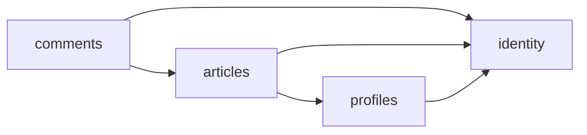

# Conduit Backend (Spring Boot)

A [RealWorld](https://github.com/realworld-apps/realworld) "Conduit" backend, a Medium.com-style publishing platform API, built as a single Spring Boot application organised as a **feature-based modular monolith**.

The contract is [`conduit-openapi/openapi.yml`](conduit-openapi/openapi.yml). Everything is served under `/api/v1`, plus `GET /health` outside the prefix. Data is stored in PostgreSQL through Spring Data JPA, with the schema owned by Flyway migrations.

**Stack:** Java 25 · Spring Boot 4 · Spring Web MVC · Spring Security (stateless JWT) · Spring Data JPA · PostgreSQL 18 · Flyway · JUnit 5 + Testcontainers · Docker · GitHub Actions

## Contents

- [Quick start](#quick-start)
- [Features](#features)
- [Configuration](#configuration)
- [Architecture](#architecture)
- [Routes and API](#routes-and-api)
- [Persistence](#persistence)
- [Testing](#testing)
- [CI](#ci)
- [Limits](#limits)
- [References](#references)

## Quick start

Requires JDK 25 and Docker. Maven is optional because the project ships the Maven wrapper.

```sh
docker compose -f conduit-docker/docker-compose.dev.yml up -d conduit-postgres
cd conduit-backend
export JWT_SECRET="$(openssl rand -base64 48)"
./mvnw spring-boot:run
```

The API runs at http://localhost:8080/api/v1 and the health check at http://localhost:8080/health.

| Goal                      | Command                                                                  |
| ------------------------- | ------------------------------------------------------------------------ |
| Start the dev database    | `make docker/dev` (from `conduit-docker`)                                |
| Run in development        | `./mvnw spring-boot:run` (from `conduit-backend`)                        |
| Run the packaged jar      | `./mvnw package && java -jar target/conduit-backend-*.jar`               |
| Run with Docker           | `JWT_SECRET=<32+ chars> make docker/up` (from `conduit-docker`)          |
| Stop Docker               | `make docker/down` (from `conduit-docker`)                               |

`PORT` overrides the host port in the Docker setup. The database lives in the `conduit-postgres-data` named volume. The dev compose file also offers pgAdmin on http://localhost:8081 (`admin@conduit.local` / `admin`) through `docker compose -f conduit-docker/docker-compose.dev.yml up -d`.

## Features

- **Authentication**: register (`201`), login, current user, stateless HS256 JWT with a 12-hour default lifetime sent as `Authorization: Token <jwt>`.
- **Settings**: partial update of email, username, password, bio and image; absent and `null` fields are distinguished.
- **Articles**: create, edit and delete your own articles; tags; slugs derived from titles, kept unique and never equal to the reserved `feed`.
- **Feeds**: global list, personal feed of followed authors, filtering by tag, author and favorited user, pagination (default 20, maximum 50), all filtered and paged in SQL.
- **Social**: follow and unfollow authors, favorite and unfavorite articles, all idempotent.
- **Comments**: add comments, delete your own comments, newest first.
- **Profiles**: public profile with the `following` flag relative to the caller.
- **Platform**: JSON logs with request ids, CORS allow-list, request body size limit, graceful shutdown, `/health` check.

Passwords are stored as BCrypt hashes and are never returned or logged.

## Configuration

Copy `conduit-backend/.env.example` as a starting point and never commit a real `.env`. Spring reads real environment variables, so export them or use your IDE.

| Variable               | Default                 | Purpose                                               |
| ---------------------- | ----------------------- | ----------------------------------------------------- |
| `PORT`                 | `8080`                  | HTTP port                                             |
| `DATABASE_HOST`        | `localhost`             | PostgreSQL host                                       |
| `DATABASE_PORT`        | `5432`                  | PostgreSQL port                                       |
| `DATABASE_NAME`        | `conduit_dev`           | Database name                                         |
| `DATABASE_USER`        | `dev_user`              | Database user                                         |
| `DATABASE_PASSWORD`    | `dev_pass`              | Database password                                     |
| `JWT_SECRET`           | none (**required**)     | HS256 secret, minimum 32 characters                   |
| `JWT_TTL_MINUTES`      | `720`                   | Token lifetime in minutes                             |
| `CORS_ALLOWED_ORIGINS` | `http://localhost:5173` | Comma-separated list of allowed origins               |
| `LOG_LEVEL`            | `info`                  | Root log level                                        |

The application refuses to start when `JWT_SECRET` is missing or shorter than 32 characters. The Docker setup uses `DATABASE_NAME=conduit`, `DATABASE_USER=conduit` and `DATABASE_PASSWORD=conduit_local` unless overridden, and requires `JWT_SECRET`.

## Architecture

The application is split into four bounded contexts under `com.conduit.backend`. Each is a self-contained package with its own domain, use cases, persistence and HTTP adapters. A small `shared` package holds what every context needs.

### Project layout

```
conduit-backend/
  src/main/java/com/conduit/backend/
    identity/       users, registration, login, current user, settings
    profiles/       public profiles and the follow graph
    articles/       articles, tags, feeds, favorites
    comments/       comments on articles
    shared/         config, errors, logging, security, validation, web
  src/main/resources/
    application.yaml
    db/migration/   Flyway migrations V1 to V4
  src/test/         unit and integration tests
conduit-docker/     Dockerfile, compose files, Makefile
conduit-openapi/    the API contract
```

### Package layout

Every context has the same internal shape:

```
<context>/
  web/              controllers and request/response envelopes
  application/      services, rules, views
  domain/           JPA entities
  persistence/      repositories and SQL query repositories
```

### Context dependencies

Arrows point from a context to the context it depends on.



### Design rules

- Controllers contain no business logic and never expose JPA entities; they return view records wrapped in envelopes.
- Validation rules live in plain `*Rules` classes that are unit tested without Spring.
- Article, comment and feed listings are assembled with dedicated query repositories so author profile, `favorited` and `favoritesCount` do not cause N+1 queries.
- One `GlobalExceptionHandler` maps every exception to the contract error shape, and the security entry point and access-denied handler emit the same JSON.
- Spring's default error pages and problem details are disabled so no non-contract JSON escapes.

## Routes and API

All request bodies are JSON and must carry `Content-Type: application/json`. Requests without a body, such as `DELETE`, follow and favorite, do not need the header. Errors use:

```json
{
  "errors": {
    "<field>": ["message"]
  }
}
```

Timestamps are UTC ISO-8601. `bio` and `image` are always present and `null` when unset.

| Method and path                                          | Auth     | Success |
| -------------------------------------------------------- | -------- | ------- |
| `POST /api/v1/users`                                     | none     | 201     |
| `POST /api/v1/users/login`                               | none     | 200     |
| `GET`, `PUT /api/v1/user`                                | required | 200     |
| `GET /api/v1/profiles/:username`                         | optional | 200     |
| `POST`, `DELETE /api/v1/profiles/:username/follow`       | required | 200     |
| `GET /api/v1/articles?tag&author&favorited&offset&limit` | optional | 200     |
| `POST /api/v1/articles`                                  | required | 201     |
| `GET /api/v1/articles/feed?offset&limit`                 | required | 200     |
| `GET /api/v1/articles/:slug`                             | optional | 200     |
| `PUT /api/v1/articles/:slug`                             | required | 200     |
| `DELETE /api/v1/articles/:slug`                          | required | 204     |
| `GET /api/v1/articles/:slug/comments`                    | optional | 200     |
| `POST /api/v1/articles/:slug/comments`                   | required | 201     |
| `DELETE /api/v1/articles/:slug/comments/:id`             | required | 204     |
| `POST`, `DELETE /api/v1/articles/:slug/favorite`         | required | 200     |
| `GET /api/v1/tags`                                       | none     | 200     |
| `GET /health`                                            | none     | 200     |

With optional authentication anonymous calls are allowed, but a token that is present and invalid or expired is rejected with `401`.

### Error statuses

| Error                                 | Status |
| ------------------------------------- | ------ |
| Malformed JSON body                   | `400`  |
| Missing, invalid or expired token     | `401`  |
| Not the owner                         | `403`  |
| No record                             | `404`  |
| Duplicate email or username           | `409`  |
| Unsupported content type              | `415`  |
| Validation                            | `422`  |
| Unexpected error                      | `500`  |

Protected endpoints check authentication first, then existence, then ownership, then validation.

## Persistence

Flyway applies the migrations in `src/main/resources/db/migration` on startup, and Hibernate only validates the schema (`ddl-auto: validate`). Open-in-view is disabled and timestamps are `timestamptz` in UTC.

| Table          | Owner    | Notes                                                                         |
| -------------- | -------- | ----------------------------------------------------------------------------- |
| `users`        | identity | unique index on `lower(username)` and `lower(email)`; BCrypt `password_hash`  |
| `follows`      | profiles | composite primary key keeps it idempotent; self-follow is blocked by a check  |
| `articles`     | articles | unique `slug`; indexed by creation time and by author                         |
| `article_tags` | articles | ordered by `tag_position`, indexed by `tag`                                   |
| `favorites`    | articles | composite primary key keeps it idempotent                                     |
| `comments`     | comments | removed with their article through `ON DELETE CASCADE`                        |

Popular tags (the 20 most used, then alphabetical), tag, author and favorited filters and the personal feed are computed in SQL rather than in memory.

## Testing

| Layer       | Command                         | What it proves                                                                                       |
| ----------- | ------------------------------- | ---------------------------------------------------------------------------------------------------- |
| Unit        | `./mvnw test -Dtest='*RulesTest,SlugGeneratorTest,JwtServiceTest,PageParamsTest'` | Slug generation, validation rules, JWT and pagination, no database                  |
| Integration | `./mvnw test`                   | Every feature over real HTTP against PostgreSQL started by Testcontainers                            |

Run the tests from `conduit-backend`. Integration tests need Docker to be running. `./mvnw verify` runs everything and packages the application.

Contract tests, if you have `conduit-contract-tests` checked out, run against a live instance with `API_URL=http://localhost:8080/api/v1`.

## CI

`.github/workflows/ci.yml` runs these jobs:

1. **Commitlint**: commit message linting on pull requests.
2. **Backend tests**: `./mvnw verify` on Temurin 25 with the unit and Testcontainers suites.
3. **Backend build**: packaged jar uploaded as an artifact.
4. **Docker**: image build, then the compose stack is started and smoke tested through `/health`, `/api/v1/tags`, `/api/v1/articles` and the `401` on `/api/v1/articles/feed`.

Commit messages follow [Conventional Commits](https://www.conventionalcommits.org) with the scopes `conduit`, `conduit-backend`, `docker`, `ci` and `deps`.

## Limits

- Request bodies are limited to 1 MiB.
- Pagination `limit` above 50 is clamped to 50.
- JWTs are stateless, so a token stays valid until it expires and cannot be revoked individually.
- The Docker setup runs a single backend instance next to a single PostgreSQL container and is meant for local use, not for production.

## References

- [RealWorld specification](https://github.com/realworld-apps/realworld)
- [Spring Boot documentation](https://docs.spring.io/spring-boot/)
- [Spring Security](https://docs.spring.io/spring-security/reference/)
- [Spring Data JPA](https://docs.spring.io/spring-data/jpa/reference/)
- [Flyway](https://documentation.red-gate.com/fd)
- [PostgreSQL 18](https://www.postgresql.org/docs/18/)
- [Testcontainers for Java](https://java.testcontainers.org)
- [JJWT](https://github.com/jwtk/jjwt)
- [Docker multi-stage builds](https://docs.docker.com/build/building/multi-stage/)
- [Domain-Driven Design Reference – Eric Evans](https://www.domainlanguage.com/ddd/reference/)
- [MonolithFirst – Martin Fowler](https://martinfowler.com/bliki/MonolithFirst.html)
